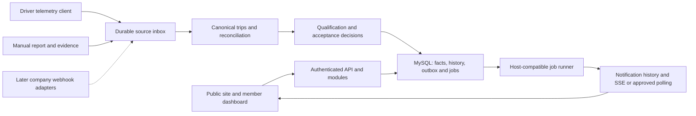

# VTC Dashboard — Project Concept

**Status:** owner-approved product baseline. Documentation delivery and review/merge evidence are tracked in [PR #1](https://github.com/senukartur/vtc-dashboard/pull/1) and the VTC-001 card below. Application implementation has not started.

**Version:** 1.0.

**Updated:** 2026-10-17.

**Planning baseline:** [MVP Trello backlog](docs/planning/mvp-trello-backlog.md).

**Card:** [VTC-001 — Confirm MVP policies, permissions, and acceptance scenarios](https://trello.com/c/GE2YTTXT/1-vtc-001-confirm-mvp-policies-permissions-and-acceptance-scenarios).

This is the main project reference for maintainers and implementation agents, following the concept-document approach used by the telemetry project. It combines the project idea, all approved VTC-001 product requirements, the working architecture direction, scope boundaries, and delivery plan. Product decisions supersede earlier proposals and narrower summaries in task cards. Candidate technical choices and external verification are explicitly separated from approved behavior.

## Project idea and user journeys

Build a modern dashboard for the Yukon Union virtual trucking company: a small community whose drivers play Euro Truck Simulator 2 and American Truck Simulator. The service provides a public company presence and a shared operational workspace for members, dispatchers, and company administrators.

A visitor learns about the company and public convoys, then submits a membership application. An administrator reviews it and provides an invitation. The accepted member sets a password, links Steam, receives per-game trainee qualifications, and can use the member dashboard.

A driver submits trips through the companion telemetry application or a manual role-play report. The dashboard preserves source evidence, resolves catalog identities, checks qualification rules, and accepts, rejects, or requests human review. Only accepted canonical trips contribute to statistics and qualification progress.

Members inspect personal/company totals, driver profiles, and trip history; sign up for convoys or decline with a reason; and receive in-app updates while the website is open. Administrators review applications and reports, configure qualifications, confirm promotions/participation, and maintain access and company connections.

## Reading map

- This document is the product and architecture starting point.
- [AGENTS.md](AGENTS.md) defines contributor/agent instructions and public-repository data-handling rules. Credentials, real driver data, private infrastructure details, and raw diagnostics must not enter public commits, PRs, or logs.
- [MVP Trello backlog](docs/planning/mvp-trello-backlog.md) contains 42 MVP implementation/discovery cards, 11 later cards, ownership boundaries, dependencies, CI/deployment work, and the parallel-agent protocol.
- [Trello card index](docs/planning/trello-card-index.md) links directly to the imported tasks.
- [VTC-001 requirements record](docs/product/mvp-policies.md) preserves the earlier document path and points to this approved baseline.
- The permission matrix, source-specific timing, and acceptance scenarios below are normative product requirements. The working stack and architecture remain subject to VTC-002–005 verification.

## Product scope and constraints

- One VTC with approximately 10–30 members, supporting ETS2 and ATS, Russian and English, and phone/tablet/desktop layouts.
- Public landing and membership application, invitation-based email/password login, member dashboard, driver directory/profiles, trip reporting/review, qualifications, events, notifications, and administration.
- Steam is a linked identity rather than the primary login method; basic TruckersMP integration is included.
- MVP trip sources are personal-token telemetry and manually submitted reports. Telemetry uploads must be durable and retry-safe; there is no requirement to store per-second telemetry on the server.
- Keep one canonical trip with preserved source evidence, language-independent catalog IDs, and extensible source/rule boundaries. Source retries or reconciliation must not multiply statistics or qualification progress.
- Production hosting targets approximately USD 35/year on the existing Hostland plan. MySQL is selected; the compatibility baseline is MySQL 8.0 and Node.js 24. Exact host capability and maintenance verification belongs to VTC-004.
- Start with new data: there is no migration of accounts or trips from either existing website.
- Full Trucky/VTCBase adapters, automatic cross-provider matching calibration, visas, reputation formulas, spendable points, Web Push, custom role authoring, and advanced disciplinary automation are later work. Reputation and points are separate from qualifications and access roles.

## Working stack and architecture

The frontend direction is TypeScript, React, Vite, shadcn/ui, Tailwind, TanStack Query, React Hook Form/Zod, i18next, and Recharts. The backend direction is Node.js 24 LTS, TypeScript, and Fastify, with MySQL 8.0, Drizzle/mysql2, and Better Auth's MySQL adapter. MySQL is owner-selected; library versions, adapter compatibility, runtime patches, and the deployment model must be finalized through VTC-004/VTC-005.

Use a modular monolith with explicit identity/admissions, catalog, telemetry/source, trip/reconciliation, qualification, event, notification, and analytics modules. Keep business rules out of React components. Start with one deployable service where the host supports it, database-backed durable jobs/outbox, and replaceable source, email, and evidence-storage adapters.

This diagram describes responsibilities, not deployed components. Redis, microservices, and per-second server telemetry storage are not MVP dependencies.

### Telemetry and extensible source ingestion

- A driver creates a personal token and pastes it into the telemetry application. Tokens belong to authenticated members, are scoped/revocable, and must not allow a client to select a different trip owner.
- Accept versioned start/completion/cancellation summaries with stable source/event identities, game/build context, real timestamps, units, and recording-completeness information as verified by VTC-003. Do not assume a field exists merely because the dashboard needs it.
- Acknowledge only after durable storage; handle retries, offline delivery, late/out-of-order events, and restarts idempotently. Old replayed events must not appear as current live activity.
- Preserve immutable source records and normalized facts/provenance alongside one canonical trip. Distinguish game outcome, evidence completeness, and company acceptance.
- Deduplicate exact replays using scoped unique source/event identities. Reconcile manual/telemetry overlap using verified ownership, known facts, and reviewed matching rules; ambiguous candidates require review. Preserve source evidence, audited reversible merge/unmerge, and recomputation.
- Future Trucky/VTCBase webhooks are company-wide connections configured by director/deputies, not by individual drivers. The architecture must accept new adapters without creating a second acceptance/statistics pipeline.
- Full Trucky/VTCBase adapters and real three-provider matching calibration are later work. The owner confirmed that VTCBase's Discord-documented hooks can target ordinary service endpoints; actual payload/auth/retry contracts remain to be verified.
- This repository does not implement the desktop client. Synchronization changes require a coordinated contract and verification in [ets2telemetry](https://github.com/senukartur/ets2telemetry); existing desktop capability is not proof that upload integration exists.

### Game catalogs and localization

Maintain local, versioned catalogs for ETS2/ATS cities, regions, cargo, and trailer classifications. Investigate reliable data/API/extraction sources in VTC-002 before promising complete coverage.

Canonical identity is independent of RU/EN labels. Prefer provider/game IDs and scoped mappings; name-only aliases need game, locale, region/map context and an ambiguity path. Changing language must not alter selected IDs or rule outcomes. Distinguish cargo unit mass from actual shipment mass.

Track game build, DLC/map coverage, provenance, publication version, and additions/changes/retirements. Preserve historical entities and rule references after DLC updates. Use an explicit import/diff/review/publish workflow; arbitrary mod support is later work.

### Data, jobs, and application boundaries

- Use InnoDB transactions, foreign/unique keys, utf8mb4 text, explicit exact comparison for opaque IDs/hashes, UTC persistence, normalized metric units, and lossless ID/decimal handling.
- Commit domain changes and outbox events together. Claim jobs through transactional leases, bounded batches/retries, and idempotent effects; test the selected MySQL locking behavior with concurrent consumers.
- Shared-host process lifetime is an early gate. Persistent workers/SSE remain candidates until verified. If necessary, explicitly approve bounded cron processing/authenticated polling and document the changed latency.
- Keep MySQL migrations serialized and reviewed. DDL may implicitly commit; use compatible additive changes, forward repair, and rehearsed backup/restore rather than claiming transactional schema rollback.
- Match the verified Node.js/MySQL family, version/configuration, timezone, and SQL modes across local development, CI, temporary hosting, and production. Never plan a later PostgreSQL-to-MySQL conversion.
- Enforce permissions on the server and filter notification/evidence recipients; UI hiding alone does not authorize access. Audit privileged changes without exposing passwords, invitation/reset/transfer secrets, or telemetry tokens.
- Transactional email is behind an adapter; Resend is a research candidate. Verify current quotas, sender requirements, and costs in VTC-014. Routine trip notifications remain in-app.
- Store screenshots behind authorized evidence access through a portable blob adapter with validated file types/limits. Verify storage capacity while preserving the approved minimum one-year retention.

## Quality, deployment, and implementation sequence

### Delivery and hosting

Production targets approximately USD 35/year, with Hostland as the intended provider and MySQL 8.0 / Node.js 24 as the compatibility baseline. These are public project constraints, not disclosure of a hosting account's tariff, billing, inventory, or deployed runtime. The [backlog's public-safe hosting summary](docs/planning/mvp-trello-backlog.md#hostland-preliminary-findings-2026-10-16) records the remaining checks; keep account-specific verification evidence private.

VTC-004 must verify actual patches/maintenance, Fastify startup under the provider's Node.js/Passenger setup, SSH/deployment access, TLS, persistent files, database privileges/limits, jobs/cron, and long-lived notification behavior. Do not assume Docker is available. Build in GitHub Actions and deploy a compatible artifact over SSH as a candidate workflow, then prove it on the account.

Temporary development hosting may differ, but its spending limit is not approved. Use local/free options until a budget is agreed, document sleep/expiry/file-persistence limits, and keep Node.js/MySQL compatible with the target. Rehearse transfer of newly created system data and evidence; no legacy-site import is included.

Production deployment must use a CI-verified revision, serialize migrations/deployments, run readiness/smoke checks, maintain recoverable database/evidence backups, and pass a restore/failed-deploy rehearsal. Measure actual capacity and annual costs before launch.

### Tests, review, and CI

- Unit tests cover business behavior such as rule evaluation and metric calculations.
- Real MySQL integration tests cover transactions, migrations, duplicate ingestion, concurrent decisions, leases, reconciliation, and permissions. SQLite or MariaDB is not a substitute test engine.
- Contract fixtures coordinate the telemetry client/API and frontend/backend work, including missing data and RU/EN mappings.
- Playwright covers a small CI smoke suite and later cross-module desktop/mobile journeys: application/invitation, login, reports/review, promotions, events, notifications, and privileged operations.
- PR CI is planned to run formatting/lint/type/build checks and relevant unit/integration/contract/browser checks, with useful failure artifacts and no deployment secrets in untrusted PR jobs.
- Changes need review appropriate to their risk. Automated review integration, repository protection, and account/plan availability are explicit VTC-009/VTC-010 work; their inclusion in this concept does not mean they are configured.
- The 42 approved acceptance scenarios below are requirements for implementation tests and pilot evidence, not claimed passing test results.

### Phases and coordination

| Phase | Main cards | Exit evidence |
| --- | --- | --- |
| Product, catalog, telemetry, host discovery | VTC-001–004 | Approved policies and resolved external assumptions |
| Architecture, scaffold, persistence, UI foundation | VTC-005–007, VTC-012 | Stable contracts and shared ownership |
| Quality, review, early development deployment | VTC-008–011 | Real quality gates and verified development launch |
| Identity, admissions, catalogs, jobs, sources, reports | VTC-013–026 | Integrated member and trip foundations |
| Rules, qualifications, acceptance, analytics | VTC-027–033 | Correct unique-trip decisions and reproducible progress |
| Events, notifications, administration | VTC-034–038 | Integrated permission-aware member workflows |
| Hardening, regression, production rehearsal, pilot | VTC-039–042 | Restore/deploy evidence and owner-approved MVP release |

Card numbers are stable identifiers, not a mandatory serial schedule. Use the dependency graph and module ownership in the backlog. Give each implementation agent one bounded card and its own branch/worktree; coordinate root tooling, contracts, migration journals, and shared integration points through their owner.

## Permission matrix

Administrative roles add permissions to the user's member roles; game qualifications do not grant administrative access. The detailed visibility rules below also apply to every action.

| Action | Trainee / Driver | Dispatcher | Deputy Director | Director |
| --- | --- | --- | --- | --- |
| Read member dashboard, accepted trips, directory, qualifications, company statistics | Yes | Yes | Yes | Yes |
| Submit own reports, manage own telemetry token, respond to events | Yes | Through member role | Through member role | Through member role |
| Read own pending/rejected reports and evidence | Yes | Yes | Yes | Yes |
| Review other members' manual/disputed trips and evidence | No | Yes | Yes | Yes |
| Approve own manual report | No | No | No | No |
| Review applications and issue/copy invitations | No | No | Yes | Yes |
| Manage events and confirm actual participation | No | No | Yes | Yes |
| Read another member's event-decline reason | No | No | Yes | Yes |
| Configure qualifications and confirm promotion | No | No | Yes | Yes |
| Administer users/roles, deactivate or reinstate ordinary members | No | No | Yes | Yes |
| Replace a member's Steam link on request | No | No | Yes | Yes |
| Configure company integrations and reporting settings | No | No | Yes | Yes |
| Transfer leadership | No | No | No | Serving director only, with email code |
| Delete/deactivate the serving director or remove the Director role outside succession | No | No | No | No |
| Change the director's email/login credentials | No | No | No | Self-service with confirmation via current verified email |

Anonymous visitors may view public landing/event content and submit membership applications. Member-only data, event participant lists, and decline reasons are not public.

## Confirmed roles and responsibilities

The five MVP roles are Trainee, Driver, Dispatcher, Deputy Director, and Director. A user may hold multiple roles; qualifications are separate from access permissions.

| Role | Confirmed responsibility |
| --- | --- |
| Trainee | Standard member capabilities; driving restrictions are defined by qualification. |
| Driver | The same standard member capabilities as a trainee; driving restrictions are defined by qualification. |
| Dispatcher | Review manual trip reports and investigate disputed trips. |
| Deputy Director | The same administrative permissions as Director, except director-only leadership transfer and protected changes to the serving director's account. |
| Director | Full administrative access, including membership applications, event management, users, qualifications, and company integrations. |

There must be exactly one director after the initial company bootstrap. Administrative roles are additive: the director can also hold Driver and have independent ETS2/ATS qualifications. Assigning an administrative role must not replace driver membership or qualification history. Trainee-to-driver promotion changes only those membership roles and preserves other assigned roles.

Do not delete or deactivate the serving director or remove their Director role without the director-only succession workflow below. A deputy cannot transfer leadership through direct role assignment or remove/deactivate the serving director. Do not allow multiple directors as an implementation shortcut.

The deputy's permission parity includes applications/invitations, event management and participation confirmation, private decline reasons, manual/disputed report review, qualification configuration and promotions, user/role administration, Steam replacement, and company integrations. Leadership succession and protected changes to the serving director's account remain exclusive to that director. General constraints such as the prohibition on approving one's own manual report apply to both roles. In the workflows below, director administrative responsibilities also apply to the deputy except for those explicitly protected operations.

Membership application review and event management belong to the director and deputy in the MVP. Separate recruitment and event-organizer roles are deferred. Joining or responding to an event is a standard member capability, distinct from managing it.

## Director-only leadership transfer

- The serving director selects another active member and confirms transfer. Only the serving director may authorize this operation.
- Change the Director role in one atomic operation so exactly one director remains. The former director retains Driver membership, game-specific qualifications, and historical trips.
- Require the email-code verification below before executing transfer.
- Deputy administration must not provide an alternate path to succession. Implementation must enforce bounded attempts/send rates, concurrency safety, and replay protection.

### Confirmed email-code verification

- Send a one-time code to the serving director's verified email. The code is bound to that director and the selected successor, expires after ten minutes, and is invalidated after use or replacement. Apply bounded attempts and send throttling during implementation.
- Execute the atomic transfer only after the serving director enters the valid code. A changed successor requires new confirmation.
- Only the serving director may change their email or login credentials, with confirmation through the existing verified email. Deputies cannot change those settings, redirect the transfer code, or recover access through an administrative bypass.

## Confirmed access and visibility

| Capability or information | Confirmed access |
| --- | --- |
| View the dashboard and company statistics | Standard members, including trainees and drivers. |
| View the driver directory and other members' qualifications | Standard members. |
| View accepted trips of other members | Standard members. |
| Submit a manual trip report | Trainees and drivers. |
| Generate a personal telemetry token and submit telemetry trips | Trainees and drivers. |
| View events and respond to participation requests | Trainees and drivers. |
| View a manual report awaiting review, rejection reasons, or attached evidence | The report's author and authorized staff: dispatchers reviewing trips, directors, and deputies. This information is not generally visible to other members. |
| Review membership applications | Director or deputy. |
| Create and manage events | Director or deputy. |
| Review manual reports and disputed trips | Dispatcher, director, or deputy. A manual report must be reviewed by someone other than its author; no role may approve its own report. |
| Configure company-wide webhook integrations | Director or deputy; external provider adapters remain deferred as defined in the backlog. |
| Transfer company leadership | Serving director only, with additional verification. |

Accepted-trip visibility does not make its restricted rejection/review history or evidence public to other members. Public event information on the landing page remains supported by the planning baseline; member-only driver and trip visibility does not imply anonymous public access.

## Trainee and driver equivalence

Trainees and drivers have the same basic dashboard capabilities. Qualification rules determine which loads, trailers, and other supported trip conditions are permitted; trainee status does not impose an additional set of website restrictions.

Qualifications remain separate for ETS2 and ATS. The confirmed initial progression in each game is **Trainee → Driver III → Driver II → Driver I**, with configurable names and requirements. MVP promotion progress uses accepted-trip count and total distance. Minimum tenure, cargo-damage criteria, and other promotion metrics are outside the initial MVP promotion requirements. Future reputation and spendable points must not be used as implicit MVP permissions.

## Qualification configuration before launch

- The initial supported qualification restrictions are maximum cargo mass, allowed trailer types, and hazardous-cargo category permissions (ADR), configured separately for each level and game.
- Keep restriction types extensible as specified in the planning baseline. The initial set is not a hard-coded limit on future rule types.
- The director configures actual qualification limits and accepted-trip/distance promotion thresholds before launch. No concrete numeric values have been supplied or approved during this clarification.
- Implementation may proceed with the agreed configuration model and clearly identified test fixtures; actual production values remain a director-owned launch prerequisite rather than invented defaults.

## Qualification timing and promotion

- For trips with a known actual start time, evaluate the driver's qualification and rule versions effective at that start, independently of submission or processing time.
- A qualification or rule change during such a trip does not change the versions used to assess it. A delayed report with a known start uses the historical versions applicable at that start.
- If the trip start time is unknown, require manual review rather than automatically substituting receipt or completion time.
- The system calculates promotion progress and signals when the defined requirements are met. The director or deputy confirms promotion; meeting a threshold alone does not automatically change a role or qualification.
- Director/deputy confirmation applies both to the transition from trainee to driver and to subsequent qualification levels.
- Each level has a separate promotion-progress period beginning when that level is assigned in the relevant game. For telemetry trips, count accepted trips started after that assignment; trips from earlier levels remain in historical statistics but are not reused for the next promotion.
- For manual reports without a trip date, use the qualification and rule versions effective at confirmation/acceptance. Attribute their progress to the game-specific qualification level assigned at that confirmation time. This is an explicit source-specific policy and does not establish an actual trip-start timestamp.
- After director/deputy-confirmed completion of the trainee stage in at least one game, the user receives the global Driver role instead of Trainee. The other game's qualification and restrictions remain unchanged; the driver may therefore have Driver III in ETS2 and Trainee qualification in ATS.
- When an accepted trip is corrected or its acceptance is revoked, recalculate affected statistics and qualification progress. If the change invalidates the requirements for a previously confirmed promotion, notify the director and retain the assigned qualification until the director decides what to do. Never automatically demote a driver.

## Qualification exceptions for company events

The owner confirmed the current company policy: qualification restrictions do not prevent participants in a company-wide event from carrying the load prescribed by that event, regardless of their ordinary qualification level. This exception is part of the event policy, rather than a separate discretionary waiver that the director must grant to each participant.

The event's conditions determine the permitted load. For the MVP, a driver selects the event when submitting the report, and the director confirms actual participation. An RSVP alone does not establish participation. Automatic association of telemetry trips using event conditions may be added later; it is not an MVP prerequisite.

Accepted trips for a confirmed company-wide event count toward qualification progress, including when the prescribed load would be outside the driver's ordinary qualification limits. They contribute accepted-trip count and distance within the relevant level's progress period and count in company statistics as accepted canonical trips, without duplicate effects. Actual numeric thresholds are configured by the director before launch.

For the agreed initial restriction types, the prescribed-load exception covers ordinary cargo-mass, trailer-type, and hazardous-cargo qualification limits. The previously agreed evidence and review workflow still applies.

## Event responses, reminders, and privacy

- Members may change their participation response until the event starts. A decline requires a reason.
- After the event starts, the director records actual attendance separately from the member's prior response. The previously agreed director confirmation is used for event-trip participation.
- Send an in-app reminder one hour before the event starts to members whose response is Participating. Notifications are delivered while the website is open; Web Push remains deferred.
- Show the nearest upcoming event in the header to VTC members who may access that event, regardless of their participation response.
- The list of members who signed up is visible to VTC members with access to the event. A decline reason is visible only to its author, the director, and deputies, reflecting the deputy's confirmed administrative parity.
- Public event pages do not expose the participant list or decline reasons.

Response and actual attendance are distinct facts. Participation is voluntary in the MVP: members may leave an event unanswered, and the system imposes no automatic penalty for declining or not attending. The director can view responses and actual attendance, subject to the confirmed privacy rules.

Notify signed-up participants inside the website when the start time or route changes or the event is cancelled. A time change reschedules the one-hour reminder; cancellation removes scheduled reminders. Keep the participation response when an event changes, and allow members to change it until the revised start time.

## Membership application fields

The owner approved the following field set for the public membership application.

| Field | Requirement |
| --- | --- |
| In-game nickname | Required. |
| Email for the invitation | Required. |
| Steam profile link | Required. |
| Games played | Required: ETS2, ATS, or both. |
| Discord | Optional. |
| Short introduction | Optional. |

Application review is the director's or deputy's responsibility. The required email is retained even when an invitation is delivered manually through another channel.

## Application decisions and invitations

- A director rejecting an application must provide a reason. Email the reason to the applicant and preserve the application and decision history.
- Rejected candidates may submit a new application; rejection does not erase the prior application.
- After approval, provide a one-time invitation link for setting the account password, valid for seven days.
- Support both email delivery and a director-facing copy-link action for manual delivery through Discord or another messenger. Manual delivery must not depend on successful email delivery; the dashboard is not required to send messenger messages itself.
- The same one-time use and expiry rules apply regardless of delivery channel. Reissuing an invitation invalidates its previous link.

## Departure and account deactivation

- Deactivate the account when a member leaves the company. Block dashboard sign-in, revoke existing sessions, and revoke personal telemetry tokens.
- Retain the member's trips, statistics, and action history. Display a Former member indicator on the profile.
- This workflow uses deactivation rather than deleting the account and its historical contributions. The sole-director protection above applies.
- On a former member's return, restore the same account and historical trips. The director assigns roles and qualifications anew rather than automatically restoring earlier privileges. Previously revoked sessions and telemetry tokens remain invalid; the driver creates a new telemetry token.

## Steam identity changes

- Only the director or deputy may replace a linked Steam profile, following a driver's request. Preserve an audit history of the identity change.
- Revoke personal telemetry tokens when the linked profile changes. Previously recorded trips remain owned by the same local user; changing the Steam link must not transfer historical trips to another user.
- Verification of Steam ownership and provider-specific mapping behavior belong to the identity/telemetry integration work; this policy does not authorize bypassing identity verification.

## Manual report review and resubmission

- Every manual report requires a different authorized reviewer. Dispatchers, deputies, and directors may not approve their own manual reports; there are no role-based exceptions.
- The author may correct a rejected manual report and resubmit it for review.
- Resubmission creates a new report revision for the same canonical trip. Preserve the previous version, rejection reason, and review history.
- A corrected submission must not create a second trip or duplicate statistics, qualification progress, or other trip effects.
- Every manual report must include at least one screenshot of the trip completion/results screen. Telemetry-confirmed trips do not require a screenshot.
- While a report awaits a decision, its author may edit it; preserve the changes in its revision history. A review decision must apply to the revision actually reviewed.
- After acceptance, the author requests a correction from a dispatcher, deputy, or director instead of directly editing the accepted record. Staff changes must retain an audit history and recalculate affected statistics. The prohibition on approving one's own manual report still applies.
- There is no submission deadline for manual reports in the MVP. The manual form does not collect the trip date; its reporting period is determined by confirmation, as specified below.

The required manual-report fields are game, origin city, destination city, cargo, cargo mass, trailer type, actual driven distance, and at least one screenshot. Event association and a comment are optional. Do not request a trip date. Undated manual reports require human review and use qualification/rules and progress attribution at confirmation time as agreed above.

## Screenshot retention

- Retain report screenshots for at least one year after the report's latest decision.
- Do not remove screenshots while a report is under review. Retention cleanup must account for renewed review and later decisions.
- Screenshot expiry does not remove the trip's structured data or decision history.
- File formats, per-file limits, image processing, and storage-capacity validation are implementation/operations work in VTC-025 and VTC-039. Do not treat the expected low upload volume as measured capacity evidence.

## Analytics metrics and period attribution

- Headline trip totals and distance statistics include accepted canonical trips only. Display pending-review and rejected trips as separate counters rather than including them in accepted totals.
- Sum actual driven distance. Retain planned route length as a separate metric; do not mix it into actual-distance totals.
- A manual report supplies actual driven distance, which the reviewer verifies against its screenshot.
- Corrections and acceptance revocation recalculate affected statistics without counting the canonical trip twice.
- For telemetry trips, attribute reporting periods to the actual trip completion date/time, including telemetry delivered after the trip finished.
- For manual reports without a trip date, attribute reporting periods to the report's confirmation/acceptance date/time, rather than an invented trip-completion timestamp.
- Preserve the distinction between trip timestamps and review/acceptance timestamps. A manual report's acceptance date does not establish when the trip actually started or ended.
- Use one company-wide reporting timezone for daily/monthly statistics, configured by the director before launch.
- Display event times in the user's timezone with an explicit timezone indication. A user's display timezone must not silently change company reporting-period boundaries.

## Late telemetry after a manual report was accepted

- Represent the matching manual report and later telemetry as two sources for one canonical trip.
- If the new data would change the confirmed decision, reporting period, or qualification progress, require dispatcher/deputy/director review before applying those changes. Preserve the previously confirmed result while review is pending.
- Retain both sources and the decision history. A confirmed reconciliation recalculates affected totals/progress rather than creating another trip. Previously agreed self-approval restrictions and the prohibition on automatic demotion still apply.

## Acceptance scenarios for the confirmed decisions

1. A trainee can open the dashboard, view accepted company trips, submit a manual report, manage a personal telemetry token, and respond to an event, just as a driver can.
2. Changing from trainee to driver does not independently unlock an unrelated dashboard action; qualification changes affect supported trip eligibility rules.
3. A member can read another member's accepted trip and qualification but cannot read that member's pending manual report, rejection reasons, or evidence without the appropriate staff permission.
4. A user holding both driver and dispatcher roles retains normal driver capabilities and receives trip-review permissions. The user cannot approve its own manual report. The same restriction applies to a director.
5. A director or deputy can review applications and manage events. Trainee, Driver, or Dispatcher roles alone do not grant those management permissions.
6. An applicant must supply a nickname, invitation email, Steam profile link, and at least one of ETS2/ATS. The applicant can omit Discord and the introduction.
7. An author corrects a rejected report and resubmits it. Staff can inspect the prior revision and rejection reason; the system retains one canonical trip and sends the new revision for review.
8. A manual report without a completion-screen screenshot cannot be submitted. A telemetry-confirmed trip does not require a screenshot.
9. An author edits a pending report. The revision history retains the previous values, and a reviewer cannot approve an obsolete revision as if it were the current report.
10. An author requests a correction to an accepted report. An authorized staff member records the correction with its history; affected statistics are recalculated without creating another trip.
11. A driver submits a manual report without entering a trip date and provides the required evidence. Its age alone does not prevent submission. Once confirmed, it belongs to the reporting period containing its confirmation time, is checked against the qualification/rules at confirmation, and contributes to that game-specific level's progress.
12. A rule or qualification changes after a trip starts but before it finishes or is submitted. The assessment uses the historical versions effective at the start.
13. A driver meets the configured promotion requirements. The system shows eligibility, but the role/qualification changes only after director/deputy confirmation.
14. A trainee selects a company-wide event on a report for its prescribed load, and the director confirms actual participation. Ordinary qualification restrictions do not prevent that load; once accepted, the trip also contributes to qualification progress. An RSVP without actual-participation confirmation does not authorize the exception.
15. ETS2 and ATS each expose the configurable initial sequence Trainee → Driver III → Driver II → Driver I. Qualification progress in one game must not silently promote the driver's qualification in the other game.
16. A director confirms promotion to Driver III in ETS2. Progress toward Driver II uses accepted telemetry trips started after the Driver III assignment and manual reports confirmed while that level is assigned; earlier credited trips remain in lifetime statistics. The same progression rules apply independently in ATS.
17. A member finishes the trainee stage in ETS2 but remains a trainee in ATS. Their global role becomes Driver, while the ATS qualification remains Trainee with its restrictions.
18. A director configures the production limits and promotion thresholds independently for each level and game before launch; implementation fixtures are not presented as approved company limits.
19. A corrected or revoked trip reduces the progress that justified an existing promotion. The system recalculates the affected totals and alerts the director, while retaining the assigned qualification pending the director's decision.
20. Before an event starts, a member changes Participating to Declined and supplies a reason. After the start, response editing is closed and the director records actual attendance separately.
21. One hour before an event, an in-app reminder targets members who selected Participating. The upcoming-event header remains visible to other VTC members who may access the event.
22. A VTC member can view the event's signed-up participant list but cannot read another member's decline reason without the Director or Deputy Director role. An anonymous visitor to a public event page sees neither the participant list nor decline reasons.
23. A director rejects an application with a reason; the applicant receives the reason by email and may submit another application while the earlier decision remains in history.
24. A director approves an application and copies its invitation link for manual delivery through Discord. The candidate can use the link to set a password within seven days, without relying on the email having been delivered. A consumed, expired, or replaced invitation cannot be reused.
25. A member leaves the company. Their existing session and telemetry token no longer grant access, while their profile is marked Former member and historical trips/statistics remain available according to the agreed visibility rules.
26. A telemetry trip finishes in January and arrives later. Use its actual January completion time for reporting-period attribution. A manual report without a trip date, confirmed in February, belongs to the February reporting period.
27. A pending or rejected report does not increase accepted-trip totals or accepted distance. Accepting it adds one canonical trip; correcting or revoking acceptance updates the affected totals rather than adding another trip.
28. A manual report records actual distance that differs from planned route length. The reviewer verifies the actual value against the screenshot; company and qualification-distance totals use the actual distance.
29. A previously accepted manual report receives matching telemetry that would change its reporting period or progress. The system retains one canonical trip and the confirmed result pending staff review; only a reviewed decision applies those changes.
30. A member leaves an event unanswered or signs up but does not attend. The director can record actual attendance, but the MVP does not impose an automatic penalty.
31. An event's start time changes. Signed-up participants receive an in-app update, their responses are preserved, response editing follows the revised start, and the one-hour reminder is rescheduled. Cancelling the event notifies them and removes its scheduled reminders.
32. A manual report includes game, origin/destination cities, cargo, mass, trailer type, actual distance, and a screenshot, while omitting the optional event/comment and any trip date. The form accepts that field set for review.
33. Two members use different display timezones. Company daily/monthly totals use the same configured reporting timezone; event times are displayed in each user's timezone with an explicit label.
34. A report screenshot is younger than one year since the latest decision or its report is under review. Retention cleanup must preserve it; expiry of an eligible older screenshot does not erase trip facts or decision history.
35. A former member returns. The same account and trip history are retained, the director assigns roles/qualifications anew, and old sessions/tokens remain invalid.
36. A director also holds Driver III qualification in ETS2. Their administrative role does not replace Driver membership or alter their game-specific qualification limits.
37. An operation would delete/deactivate the sole director, remove the Director role outside succession, or assign a second director. The operation is rejected. A deputy's general role-administration permissions cannot bypass this protection.
38. A director changes a driver's linked Steam profile after a request. The change is audited, telemetry tokens are revoked, and historical trips retain their local owner.
39. A deputy performs application/event/user administration, qualification promotion, Steam replacement, or integration configuration under the same constraints as the director. A leadership-transfer request from that deputy is rejected.
40. The serving director transfers leadership to another active member after the required additional verification. Exactly one director remains, and the former director retains driver membership, qualifications, and trip history.
41. The serving director selects a successor and receives a one-time code at their verified email. A code older than ten minutes, already used/replaced, or associated with another successor cannot authorize transfer.
42. A deputy attempts to change the serving director's email/login credentials or bypass succession through role administration. The operation is denied; a director's own credential change requires confirmation through the current verified email.

These are approved requirements scenarios, not evidence that the application is implemented or tested. Administrative examples apply equally to a deputy unless the action is explicitly reserved to the serving director.

## Configuration and implementation follow-up

No product-policy question remains open in VTC-001. These follow-ups have named owners and do not authorize inventing company limits or claiming that the application is implemented.

| Follow-up | Responsible cards | Required before |
| --- | --- | --- |
| Configure actual per-game qualification limits, promotion trip/distance thresholds, and company reporting timezone | VTC-028, VTC-031, VTC-032, VTC-038, VTC-042 | Production launch |
| Verify game/DLC catalog sources, coverage, identifiers, trailer/ADR mappings, and update workflow | VTC-002, VTC-019 | Catalog-dependent implementation |
| Verify telemetry fields, timestamps, missing-data behavior, and Steam ownership/provider mappings | VTC-003, VTC-018, VTC-024 | Real ingestion/identity integration |
| Verify Hostland runtime/database versions, security maintenance, execution model, and annual cost | VTC-004, VTC-041 | Deployment choice and launch |
| Implement uploads, choose tested file limits/formats, and verify capacity for one-year evidence retention | VTC-025, VTC-039, VTC-041 | Production uploads |
| Implement and test director-code expiry, attempt/rate limits, replay/concurrency handling, and protected account changes | VTC-013, VTC-014, VTC-038, VTC-039 | Leadership transfer availability |
| Review and merge the concept/requirements PR and link evidence to Trello | VTC-001 | Documentation delivery completion |

Implementation cards must use this policy version for roles, manual-report timing, event exceptions, and historical decisions. Later policy changes require an explicit recorded decision and updates to affected contracts/tests.

## VTC-001 acceptance evidence

| Acceptance criterion | Approved evidence |
| --- | --- |
| Record product scope and manual/telemetry validation | Product scope, trip workflows, and source-specific timing above |
| Publish permissions, levels, trainee/promotion rules, and event exceptions | Permission matrix; independent Trainee → III → II → I progression; count/distance metrics; staff-confirmed promotion; event exception |
| Decide effective time, evidence/editing/deadlines, departures, events, and metrics | Timing policies, manual form/revisions, one-year screenshots, departure/return, RSVP/privacy, and analytics |
| Separate roles, qualifications, reputation/points; record budget | Additive role model, independent game qualifications, deferred reputation/points, approximately USD 35/year target |

All product criteria were confirmed by the owner in this conversation, including the final email-code mechanism and director-account protection. The Trello card records requirement approval separately from repository review/merge. The common Definition of Done still applies to documentation delivery; an open PR and an approved requirement do not establish a merged PR or passing feature tests.

## References and document maintenance

- [VTC Dashboard repository](https://github.com/senukartur/vtc-dashboard) and [Trello board](https://trello.com/b/NwhwurSM/vtcdashboard).
- [Telemetry repository](https://github.com/senukartur/ets2telemetry) and its [concept](https://github.com/senukartur/ets2telemetry/blob/main/concept.md) are integration context; this dashboard's owner-selected MySQL decision supersedes the older server-stack suggestion for this repository.
- [Detailed discovery and primary-source references](docs/planning/mvp-trello-backlog.md#9-research-and-integration-references) cover catalogs, SDKs, provider APIs, UI, database/runtime documentation, hosting, and email research. Recheck external behavior and terms during the responsible discovery card.

Write repository documentation in English; product localization is Russian and English. Keep this concept authoritative for cross-cutting product requirements, the backlog for execution scope/dependencies, and implementation contracts/ADRs for verified technical detail. Record later owner-approved changes and update affected cards/contracts/scenarios together. Keep dated observations distinct from current implementation evidence.
