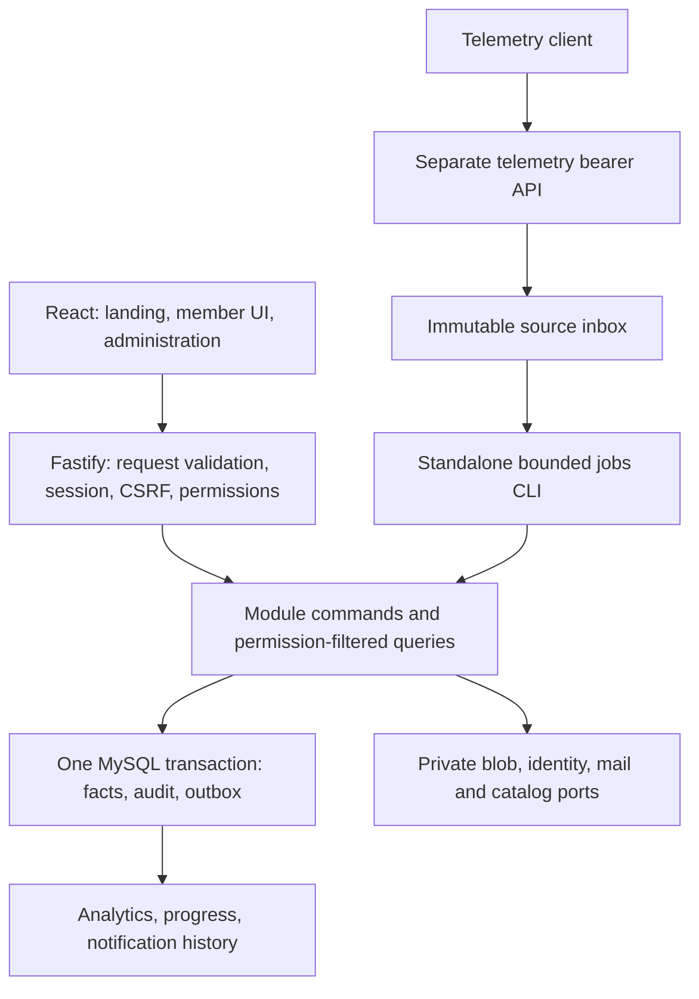

# VTC-005 architecture baseline

**Status:** implementation specification; adoption and independent review are tracked in [PR #5](https://github.com/senukartur/vtc-dashboard/pull/5) and VTC-005. The [review correction record](review-vtc-005.md) describes the five read-contract fixes. These documents specify future software, not implemented services. Product policy remains in [CONCEPT.MD](../CONCEPT.MD).

Read the [stack decision](../decisions/stack.md), [module boundaries](modules.md), [data/transaction rules](data-and-transactions.md), [adapter interfaces](ports.md), and [dashboard contract](../contracts/dashboard/README.md). The existing [telemetry v1.0 contract](../contracts/telemetry-v1.md) is unchanged.

## Shape and runtime

Use a TypeScript modular monolith, a React SPA and one MySQL 8.4/InnoDB database. The server exposes browser APIs and the separate bearer-authenticated telemetry surface. Build the web assets and server in CI. A single Node.js HTTP process serves the same-origin UI/API; the same server modules also expose an independent bounded jobs CLI. All durable state is in MySQL/private blob storage. No Redis, microservices, distributed transaction service or per-second telemetry storage is needed.



The diagram describes responsibilities, not separate deployments. Expensive projections and mail retry outside HTTP through durable jobs. Permission checks and authoritative acceptance decisions never depend on a stale browser cache or a queue's eventual projection.

## Repository layout

```text
apps/api/src/
  app.ts                    # creates Fastify without listening
  server.ts                 # one HTTP entry, shutdown and readiness
  jobs.ts                   # bounded CLI entry, no HTTP dependency
  modules/<module>/         # domain, commands, queries, routes, repositories
  use-cases/                # cross-module coordinators composed from public facades
  platform/                 # db/tx, auth bridge, authorization, jobs, outbox,
                            # configuration, storage, mail, audit, observability
apps/web/src/
  app/                      # router, providers, layouts and composition
  features/<feature>/       # UI and query hooks consuming the contract
  shared/                   # UI primitives, locale/units and transport
packages/contracts/         # generated/reviewed runtime schemas and public DTOs
packages/db/schema/         # module-owned tables and auth schema
packages/db/migrations/     # serialized journal owned by the migration integrator
test/                       # unit/integration/contract/E2E support and journeys
deploy/                     # separate staging and final-host launch adapters
```

VTC-006 creates these scaffold/ownership paths; feature modules, schema/migrations and deployment implementations remain their owning cards' work. [CONTRIBUTING.md](../CONTRIBUTING.md) describes the local Docker workflow and portable builds. Avoid importing server/database code into the web bundle. Routes validate and invoke commands; React does not implement qualification or access policy. Share transport schemas and pure value types, not repositories or service singletons. Each module exports an explicit public facade; only composition imports implementation factories.

## Request and command flow

1. Establish a trusted request origin/proxy configuration and a safe request ID. Validate content type, schema and size before command execution. Exclude credentials and private bodies from logs.
2. Browser writes require the application session/CSRF policy; public application/invitation/auth writes still receive origin/CSRF and abuse protection. Telemetry uses only its frozen bearer contract, never browser-cookie fallback.
3. Resolve current membership and effective capabilities from authoritative state. Re-check target ownership, current director, review author and relevant versions under the command's transaction locks.
4. Execute the command with an explicit transaction context passed to participating repositories; commit state, audit and outbox together. Return the committed result or durable operation handle. Network work cannot hold those locks.
5. Serialize the route's public DTO. Redaction is enforced in server queries/serializers; a caller must not receive evidence, decline reasons or private history and merely have it hidden in the UI.

## Delivery and verification

Local/CI/staging use maintained Node.js 24 and MySQL 8.4. [VTC-004](../decisions/hosting.md) assigns up to USD 20/month to separate staging and approximately USD 35/year to final Hostland. VTC-011 can finish using synthetic infrastructure probes before domain jobs/notifications exist. Feature cards later prove real leases, authorization and delivery on that staging; VTC-040 validates the integrated candidate. VTC-041 then verifies Passenger/runtime/cost and rehearses MySQL/private-file transfer. Docker is optional packaging for staging, not an application requirement on Hostland.

VTC-005 supplies interfaces and bounded compatibility evidence. VTC-006 owns root tooling; VTC-007 owns schema foundations; VTC-008/009 own real-MySQL and CI checks; VTC-013 owns authentication integration. No specification or import smoke is proof of transaction, session, real-client or hosted correctness.

The browser contract's asynchronous catalog imports require the durable operation/job platform, so VTC-019 now explicitly depends on VTC-021. This is an acyclic start prerequisite; the early VTC-011 synthetic infrastructure acceptance remains independent of feature jobs/notifications. No other feature completion is inferred from this architecture hand-off.

The [Events backend](../development/events.md) provides owned transactional definitions, voluntary RSVP, separate staff attendance and safe immutable integration references. Event UI, adjudication and notification delivery retain their downstream VTC-035/029/036 ownership.
