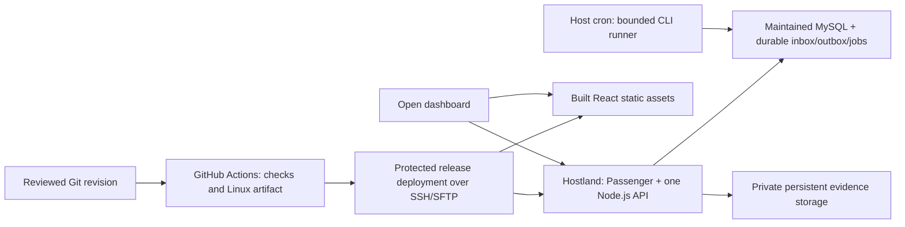

# Portable low-cost deployment direction

**Date:** 2026-10-17. **Status:** proposed; production approval blocked by [HOST-01–06](../research/hosting.md#open-gates-and-ownership). **Card:** VTC-004. No infrastructure or workflow has been applied.

## Decision boundary

Use the existing Hostland shared account as the first production candidate, provided a maintained MySQL target, patched Node.js 24, required runtime behavior, storage/recovery and an all-in cost near USD 35/year are demonstrated. Keep the modular monolith and provider-portable interfaces. A paid VPS, managed database or second production provider is not selected.

MySQL remains the selected database. On 2026-10-17 the owner approved maintained **MySQL 8.4 LTS**, conditional on the same budget, superseding the 8.0 working baseline following the [lifecycle finding](../research/hosting.md#runtime-lifecycle-finding). Actual account availability/cost and compatible patch/configuration must be proven before pinning implementation dependencies. If the condition cannot be met, seek a new decision rather than silently reverting to 8.0. Node.js remains on the supported 24 line with a verified patch/update policy.

## Deployment shape

The diagram is the recommended responsibility split, not deployed components. The same origin serves the public landing/member React app and `/api` so browser authentication does not require a second paid service or cross-origin cookie arrangement. Route precedence must keep API/evidence errors out of SPA fallback. Static assets may be served by the front server or the Node app after the actual Hostland routing is verified.

### Web process and release artifact

- Build React and transpile TypeScript in CI; ship a versioned Linux-compatible artifact. Do not copy Windows `node_modules` to Linux. Any native dependency needs a compatible ABI/libc build or a verified target install, not an assumed portable binary.
- Use Hostland's documented `server.js` entry and a single HTTP server. Passenger performs reverse port binding; verify normal Fastify startup and forwarded HTTPS headers under that loader before selecting a wrapper. Do not assume a publicly exposed application port, root/systemd, PM2, Docker or a permanently alive process.
- Candidate release layout: a fixed application root with `server.js` loader, `current` pointer to an immutable release, separate `shared` private configuration/uploads and a fixed restart marker. Symlink/atomic rename and static-root behavior must be proven on target; the diagram does not establish them.
- Keep evidence outside `public/`, release folders and SPA asset fallback. Serve it only after server authorization. Secrets stay in host-private configuration/approved environment storage, never the artifact or public GitHub variables/logs.
- Deployment from a reviewed, CI-verified revision verifies artifact checksum and host key, uploads to a new release directory, serializes migration/deploy operations, runs only compatible additive migrations, switches the release and triggers the documented restart. Health/readiness checks include database access and the intended release ID.
- Application rollback selects the previous compatible artifact. MySQL DDL is not transactionally reversible; a failed schema change may require forward repair or a tested database/file restore. Never promise that switching the release pointer rolls back data.
- VTC-009/011/041 implement this workflow. No production deployment credential, GitHub secret, environment, workflow or server directory was created by VTC-004 research.

### Jobs and notifications

The owner approved this MVP execution direction on 2026-10-17: a **minute-based cron invocation** of a short CLI runner over the same MySQL inbox/outbox/jobs. Domain events and their durable jobs commit together. Leases/unique keys make overlapping/crashed executions safe; each invocation bounds records, CPU and wall time, releases resources, and resumes later. Passenger timers are not the only scheduler. Actual CPU cost must remain below the provider's applicable limit; a suggested wall timeout alone does not enforce CPU limits. Host execution remains unverified.

The owner-approved MVP transport is an authenticated notification-history poll **every 30 seconds while visible**, paused while hidden/offline, with an immediate refresh on return and no overlapping requests. This keeps the notifications model/outbox unchanged. SSE remains an optional unverified optimization; any later adoption must validate buffering/timeouts, heartbeat/reconnect, permission filtering and concurrent tabs under actual proxy limits.

With a healthy runner, no backlog and acceptable cold start, 60-second cron scheduling plus 30-second polling adds up to approximately **90 seconds** before a due queued notification becomes visible. The owner accepted this healthy-operation target; it is not a hard worst-case guarantee or observed host performance, and failures/backlog must be surfaced. It assumes any preceding ingestion/decision jobs and their generated notifications fit the same runner invocation; additional scheduling cycles add delay and must be measured. It may consume much of the telemetry contract's 120-second live-freshness window, so older events must still suppress live toasts. This is the VTC-021/036/037 product baseline, subject to actual host compatibility and load evidence.

### Development and cost

Use local Node.js/MySQL development and standard public-repository CI first. VTC-006/008 define the reproducible local setup after the MySQL release decision; no local database installation is claimed. This avoids a new hosted recurring fee, sleep/expiry limits and preview data loss. GitHub artifact/cache storage still needs bounded retention/usage even when standard public-runner minutes are free.

Before production approval, privately total hosting renewal, required domain, TLS, screenshot and independent-backup capacity, email delivery and any required add-ons against USD 35/year. Do not convert advertised RUB hosting-only rates into a guaranteed all-in USD bill. Use real capacity/restore evidence and the approved one-year screenshot retention; do not solve a cost problem by silently dropping history or durability.

## Required exit evidence

- [x] Owner database-release and notification-latency decisions recorded; technical feasibility remains unverified.
- [ ] Provider confirms maintained runtime/database availability, patch policy, applicable limits and acceptable full cost.
- [ ] Isolated Fastify/MySQL/cron/TLS/storage/outbound smoke succeeds without modifying existing services.
- [ ] VTC-004 required findings are reviewed and merged; VTC-005 receives a verified runtime/configuration target.
- [ ] Early deployment/recovery workflows are implemented in VTC-011 and production restore/deployment proof is completed in VTC-041 before launch.

The execution checklist is in the [verification plan](../research/hostland-verification.md). Unknown facts block production approval; they do not authorize buying services, creating access or editing the existing sites.
