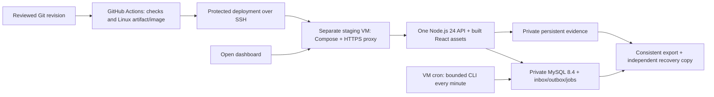

# Development-first deployment and final Hostland transfer

**Date:** 2026-10-17. **Status:** revised proposal following the owner's staging-first clarification. Separate testing budget **up to USD 20/month** is approved; the recommended platform has not been provisioned. Hostland is the final production destination at approximately **USD 35/year**, subject to its later verification. No infrastructure or workflow has been applied.

## Decision boundary

VTC-004 now selects and documents the **rapid development/testing deployment approach**. It does not require access to Hostland or a successful Passenger test. VTC-005 may finalize a locally/CI-tested Node.js 24 / MySQL 8.4 stack after this planning decision is reviewed and merged. VTC-011 implements the separate staging environment on the owner's account; VTC-040 completes cross-module regression before VTC-041 verifies and transfers to Hostland. VTC-042 retains final production smoke/pilot and release sign-off.

Recommend one **DigitalOcean Basic Regular bundled Droplet, 2 GiB / 1 vCPU / 50 GiB**, with app, real MySQL and private files on the same VM. Published base cost is USD 12/month; optional basic weekly VM backups bring the pre-tax subtotal to USD 14.40. The [comparison and budget worksheet](../research/development-hosting.md) cover AWS Lightsail, Railway and the remaining USD 20 allowance. Check actual tax/domain/backup totals before provisioning. This is a design recommendation, not a purchase or a claimed hosted result.

MySQL remains selected. The owner approved maintained MySQL 8.4 LTS following the 8.0 EOL finding; development uses that family and Node.js 24. The final Hostland availability/cost condition remains a VTC-041 release gate. If it fails later, return for a hosting/version decision instead of silently reverting to 8.0 or changing database engines. Do not wait for production-account access to pin and test compatible development dependencies.

## Staging deployment shape

This is the recommended responsibility split, not deployed components. Use one HTTPS origin for the public/member UI and `/api`, a private database network and persistent volumes outside replaceable releases. Keep evidence behind server authorization and out of static/SPA fallback. One staging environment is enough initially; do not create paid per-PR environments.

## Release and recovery workflow

- Build React/transpile TypeScript and run tests in CI. Produce a versioned Linux-compatible application artifact and, for staging, a pinned container image using that output. Do not upload Windows `node_modules`. Verify native dependencies against the actual target ABI/libc when needed.
- Implement one protected GitHub Actions deployment path in VTC-011 after VTC-009 CI succeeds. A main-branch release deploys its exact reviewed revision; manual deployment of another reviewed, CI-passed revision is available for focused testing. Verify checksum/image digest and SSH host key. Secrets stay out of public Git, artifacts and untrusted PR jobs.
- Serialize migrations/deployments, retain a compatible prior release, verify database-backed readiness and release identity, and recover from an injected failed deployment. MySQL DDL is not transactionally reversible: switching app images does not roll back schema/data.
- Prove database/synthetic-file survival across redeploy and VM reboot, and an isolated restore from a consistent export. Early VTC-011 acceptance uses isolated synthetic infrastructure probes, not the later jobs/notifications/evidence feature implementations. Name the independent backup destination/cost before pilot data is retained. VM snapshots are an additional safety mechanism, not application-consistency proof.
- Docker Compose belongs to staging/local tooling. The application keeps a normal single HTTP entry and standalone job CLI; Docker, root/systemd or a specific VPS provider must not become application requirements for Hostland.

## Jobs and notifications

Preserve the owner-approved MVP model: a bounded CLI runner invoked once per minute independently of HTTP requests, MySQL leases/idempotency against overlaps/crashes, and notification history polled every 30 seconds while visible. Pause polling while hidden/offline and refresh on return without overlapping requests or duplicate toasts. SSE remains an optional later optimization.

Approximately 90 seconds is the accepted healthy/no-backlog notification target, not an observed or guaranteed maximum. It assumes preceding processing and generated notifications fit the same invocation; additional cron stages/cold starts/failures add delay. VTC-011 uses synthetic database/cron/HTTPS probes only; real leases, recipient/session authorization and domain notification/backlog latency are proven later in VTC-021/036/037 on that staging environment and together in VTC-040. Preserve the telemetry contract's stale-live-alert suppression even when delivery is delayed.

## Final Hostland stage

Hostland-specific findings are [retained as deferred production research](../research/hosting.md). The [isolated verification plan](../research/hostland-verification.md) and [unsent provider questions](../research/hostland-provider-questions.md) belong to VTC-041. Unknown production availability, patch policy, permissions, capacity and cost block **final cutover**, not current architecture, implementation or staging.

After VTC-040 testing, VTC-041 obtains authorized production access, checks a maintained MySQL 8.4 target and patched Node.js 24, proves Fastify under Passenger, cron, TLS, private evidence, outbound integrations, deploy/rollback and database/file restore within the approximately USD 35/year budget. Production layout may use the documented `server.js`, private shared files and restart marker; actual loader/routing/symlink behavior must be tested then. Passing Docker staging tests does not prove those behaviors.

Export/import only the newly created system data and evidence selected for cutover; no legacy-site import is included. Rehearse the transfer, coordinate a consistent snapshot/write pause, validate counts/references and job recovery, and explicitly decide when staging stops writing. Remove temporary paid resources only after successful cutover, verified recovery copies and authorized teardown. VTC-042 still verifies the final environment before release.

## Delivery gates

- [x] Owner separated development/testing from final hosting and approved up to USD 20/month for staging.
- [x] Owner database family and notification timing decisions recorded.
- VTC-004 research deliverables are documented in the [backlog](../planning/mvp-trello-backlog.md#vtc-004); [PR #4](https://github.com/senukartur/vtc-dashboard/pull/4) and [Trello](https://trello.com/c/OZ84Rfk4) record final independent review/merge and card completion. Hosted execution is not required by this planning card.
- [ ] VTC-005/006/008/009 deliver tested runtime/configuration, reproducible local setup and CI.
- [ ] VTC-011 provisions staging within budget and records actual deployment/persistence/recovery and synthetic cron/poll evidence; later feature cards provide actual jobs/notification integration evidence.
- [ ] VTC-040 completes integrated testing; VTC-041 proves Hostland compatibility, annual cost, transfer and restore before final cutover; VTC-042 records final release acceptance.
